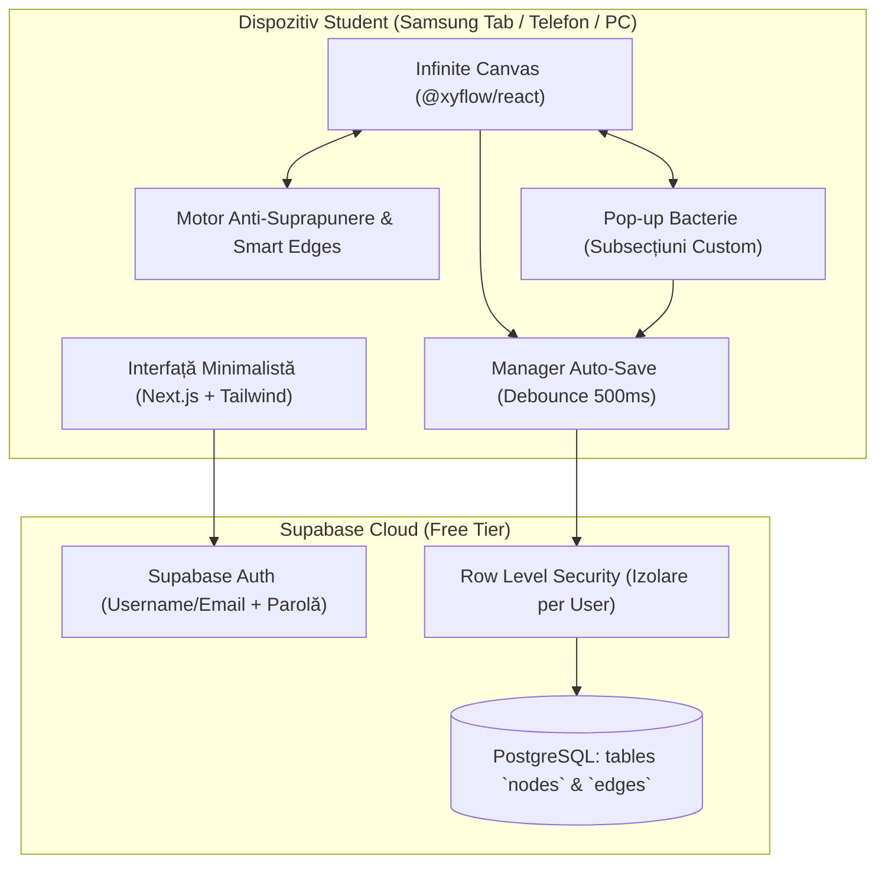

# Plan Arhitectural Detaliat — Aplicație de Învățat Bacterii (Infinite Canvas)

Acest document reprezintă **planul arhitectural și de implementare (Single Source of Truth)** după care va fi construită aplicația web dedicată studenților la medicină pentru organizarea vizuală și învățarea structurată a familiilor de bacterii.

---

## 1. Viziunea și Obiectivele Proiectului

- **Scopul principal:** Înlocuirea schemelor pe hârtie (unde spațiul este limitat) cu o **pânză infinită (Infinite Canvas)** modernă, fluidă și minimalistă, unde studenții pot construi arbori multipli cu rădăcini diferite pentru clasificarea bacteriilor (în latină).
- **Dispozitive țintă:** Web Browser (Desktop/Laptop), **Tablete (Samsung Galaxy Tab / iPad)** și Telefoane (optimizat Touch-First: pinch-to-zoom, pan cu degetul, butoane accesibile tactil).
- **Capacitate și Cost:** ~30 de utilizatori concurenți/activi, găzduit **100% Gratuit** folosind **Vercel** (Frontend) + **Supabase Free Tier** (Auth & PostgreSQL).
- **Principiu UX:** Minimalist, rapid, fără încărcări greoaie, cu salvare automată (Auto-Save) și mișcare liberă a dreptunghiurilor fără suprapuneri.

---

## 2. Stack Tehnologic

| Componentă | Tehnologie | Justificare |
| :--- | :--- | :--- |
| **Framework Frontend** | **Next.js (App Router) + TypeScript** | Integrare nativă cu Vercel, performanță excelentă, rutare simplă. |
| **Motor Infinite Canvas** | **`@xyflow/react` (React Flow v12)** | Suport nativ pentru pinch-to-zoom pe tablete, pan, noduri customizabile, linii Bezier fluide la 60 FPS și control total asupra coordonatelor `(x, y)`. |
| **Stilizare & UI** | **Tailwind CSS + Lucide React** | Design minimalist, curat, animații fluide pentru Pop-up și adaptare automată pentru ecranele tabletelor. |
| **Backend & Bază de Date** | **Supabase (PostgreSQL)** | Bază de date relațională cu suport `JSONB` pentru subsecțiunile dinamice și Row Level Security (RLS) pentru izolarea datelor fiecărui student. |
| **Autentificare** | **Supabase Auth** | Autentificare simplă cu `Username` (sau Email) + `Parolă`. |
| **Hosting & Deploy** | **Vercel** | Deploy gratuit și automat la fiecare modificare în Git. |

---

## 3. Arhitectura Sistemului & Fluxul de Date



### Cum funcționează Autentificarea Simplă (Username sau Email + Parolă):
- Dacă utilizatorul introduce un simplu **username** (ex: `alana`) fără `@`, aplicația îl transformă transparent în spate în `alana@bacterii.app` pentru Supabase Auth (cu confirmarea de email dezactivată din Supabase).
- Dacă introduce o adresă de **email** reală, o folosește direct.
- Astfel, contul se creează în 2 secunde cu **Username/Email + Parolă**, fără pași complicați.

---

## 4. Arhitectura Bazei de Date (Supabase SQL Schema)

Fiecare utilizator își vede și își modifică exclusiv propriile noduri și linii datorită politicilor **RLS (Row Level Security)**.

### 4.1. Tabelul `nodes` (Dreptunghiurile cu Bacterii)
Stochează fiecare dreptunghi de pe pânza infinită, poziția lui, culoarea și lista de subsecțiuni din Pop-up.

```sql
CREATE TABLE public.nodes (
    id UUID PRIMARY KEY DEFAULT gen_random_uuid(),
    user_id UUID NOT NULL REFERENCES auth.users(id) ON DELETE CASCADE,
    title TEXT NOT NULL DEFAULT 'Bacterie nouă',
    color TEXT NOT NULL DEFAULT '#ede9fe', -- Culoarea de fundal a dreptunghiului
    border_color TEXT NOT NULL DEFAULT '#8b5cf6', -- Culoarea conturului
    position_x DOUBLE PRECISION NOT NULL DEFAULT 0,
    position_y DOUBLE PRECISION NOT NULL DEFAULT 0,
    subsections JSONB NOT NULL DEFAULT '[]'::jsonb, -- Array de [{id, title, content}]
    created_at TIMESTAMPTZ NOT NULL DEFAULT now(),
    updated_at TIMESTAMPTZ NOT NULL DEFAULT now()
);
```

#### Structura `subsections` (`JSONB`):
```json
[
  {
    "id": "sub_1",
    "title": "Morfologie & Gram",
    "content": "Coci Gram-pozitivi, așezați în grămezi (ciorchine)."
  },
  {
    "id": "sub_2",
    "title": "Factori de virulență",
    "content": "Coagulaza, Proteina A, Toxina TSST-1."
  }
]
```

### 4.2. Tabelul `edges` (Ramurile / Liniile dintre Dreptunghiuri)
Stochează legăturile dintre dreptunghiuri (care nod părinte se leagă de care nod copil).

```sql
CREATE TABLE public.edges (
    id UUID PRIMARY KEY DEFAULT gen_random_uuid(),
    user_id UUID NOT NULL REFERENCES auth.users(id) ON DELETE CASCADE,
    source_id UUID NOT NULL REFERENCES public.nodes(id) ON DELETE CASCADE,
    target_id UUID NOT NULL REFERENCES public.nodes(id) ON DELETE CASCADE,
    created_at TIMESTAMPTZ NOT NULL DEFAULT now()
);
```

### 4.3. Securitate (Row Level Security - RLS)
```sql
ALTER TABLE public.nodes ENABLE ROW LEVEL SECURITY;
ALTER TABLE public.edges ENABLE ROW LEVEL SECURITY;

CREATE POLICY "Users manage own nodes" ON public.nodes
    FOR ALL USING (auth.uid() = user_id) WITH CHECK (auth.uid() = user_id);

CREATE POLICY "Users manage own edges" ON public.edges
    FOR ALL USING (auth.uid() = user_id) WITH CHECK (auth.uid() = user_id);
```

---

## 5. Mecanica Pânzei Infinite, a Liniilor și Anti-Suprapunerea

Pentru a îndeplini cerința: *„să mutăm noi liber, să fie dinamic la acele dreptunghiuri și linia automat și finuț și fără suprapuneri să se mute frumos după dreptunghi”*:

### 5.1. Mișcare Liberă & Fluidă (60 FPS)
- Când tragi un dreptunghi cu degetul (pe Samsung Tab) sau cu mouse-ul, starea locală din React Flow îi actualizează poziția instantaneu la 60 FPS.
- Salvarea în Supabase nu blochează mișcarea: se declanșează la finalul mutării (`onNodeDragStop`) sau cu un *debounce* de 500ms.

### 5.2. Linii Dinamice „Smart Floating Edges” (Fără încurcături)
- În loc ca o linie să rămână blocată doar în partea de sus a unui dreptunghi (ceea ce ar arăta urât dacă muți copilul în dreapta sau deasupra părintelui), implementăm **Calcul Dinamic al Punctului de Conectare**:
  - În timp ce muți dreptunghiul, aplicația calculează automat care latură (`Sus`, `Jos`, `Stânga`, `Dreapta`) este cea mai apropiată între părinte și copil.
  - Linia este de tip **Smooth Bezier Curve** (curbă fină, rotunjită) și își schimbă lin punctul de ancorare după cum rotești sau muți dreptunghiul.

### 5.3. Algoritmul Anti-Suprapunere (Collision Resolution)
- Când eliberezi un dreptunghi după ce l-ai mutat (`onNodeDragStop`) sau când creezi o ramură nouă:
  1. Verificăm dacă dreptunghiul mutat se intersectează cu oricare alt dreptunghi de pe pânză (folosind un *Bounding Box* de `lățime + 24px margine de siguranță` și `înălțime + 24px`).
  2. Dacă există o suprapunere, calculăm vectorul de depărtare și **împingem lin (cu tranziție animată)** dreptunghiul în cea mai apropiată poziție liberă, astfel încât niciun dreptunghi să nu rămână vreodată încălecat peste altul.

---

## 6. Design-ul Componentelor UI & UX (Tablet-First)

### 6.1. Paleta de Culori pentru Dreptunghiuri
Fiecare dreptunghi poate fi colorat cu un singur tap dintr-o paletă medicală pastelată (odihnitoare pentru ochi, cu contrast mare pentru textul în latină):
1. **Violet (Gram +)** — Fundal `#f3e8ff`, Contur `#9333ea`, Text `#581c87`
2. **Roz / Coral (Gram -)** — Fundal `#ffe4e6`, Contur `#e11d48`, Text `#881337`
3. **Albastru (Aerobi / Categorie)** — Fundal `#e0f2fe`, Contur `#0284c7`, Text `#0c4a6e`
4. **Verde Smarald (Anaerobi / Categorie)** — Fundal `#d1fae5`, Contur `#059669`, Text `#064e3b`
5. **Ambră / Galben (Atipice / Spirochete / Micobacterii)** — Fundal `#fef3c7`, Contur `#d97706`, Text `#78350f`
6. **Gri Neutru (Rădăcină / Familie Generală)** — Fundal `#f1f5f9`, Contur `#475569`, Text `#0f172a`

### 6.2. Design-ul unui Dreptunghi (Node Card) pe Pânză
- **Colțuri rotunjite (`rounded-2xl`)**, umbră fină (`shadow-sm`), contur de `2px`.
- **Conținut pe card:**
  - Titlul bacteriei/familiei (ex: *Enterobacteriaceae*), scris lizibil.
  - Un mic badge discret care arată câte subsecțiuni cu notițe are înăuntru (ex: `3 secțiuni`), ca să știi dintr-o privire la care bacterii ai completat deja materia.
- **Acțiuni rapide pe tabletă:**
  - **Tap scurt pe dreptunghi:** Deschide Pop-up-ul cu detalii și subsecțiuni.
  - **Buton `+` pe marginea dreptunghiului:** Creează instant un dreptunghi copil legat cu o linie fină de el, poziționat automat într-un loc liber (fără suprapunere).
  - **Puncte de conectare:** Permite și tragerea unei linii între două dreptunghiuri deja existente.

### 6.3. Pop-up-ul Bacteriei (Modalul de Învățare)
Când dai click/tap pe un dreptunghi, se deschide un Pop-up centrat, modern (cu fundal blurat în spate):
- **Header-ul Pop-up-ului:**
  - **Titlul bacteriei** (input mare, editabil direct).
  - **Selectorul de culoare** (cele 6 buline colorate — apeși pe una și dreptunghiul își schimbă culoarea pe loc).
  - **Buton `+ Ramură nouă`** (dacă vrei să creezi un copil direct din pop-up) și **Buton `Șterge nodul`**.
- **Corpul Pop-up-ului (Subsecțiunile Custom):**
  - Listă verticală cu toate subsecțiunile create de student pentru acea bacterie.
  - Fiecare subsecțiune este un card curat care conține:
    - **Titlul subsecțiunii** (editabil, ex: *„Patogenie”*, *„Diagnostic de laborator”*, *„Tratament”*).
    - **Conținutul subsecțiunii** (zonă de text auto-extensibilă unde scrii informațiile clare).
    - **Butoane de mutare (Sus/Jos) și Ștergere subsecțiune**.
  - **Butonul `+ Adaugă subsecțiune nouă`** jos (plus câteva sugestii rapide cu un singur click, ex: `+ Morfologie`, `+ Boală`, `+ Tratament`, sau subsecțiune complet goală).

### 6.4. Bara Plutitoare Minimalistă (Top/Bottom Toolbar)
O bară subțire, tip „capsulă” (glassmorphism), care nu ocupă spațiu pe ecranul tabletei:
1. **`+ Rădăcină Nouă`**: Pune pe pânză un dreptunghi nou, independent, de unde poți începe un arbore nou.
2. **`Căutare rapidă` (Search)**: Tastezi numele unei bacterii și pânza face zoom lin direct pe dreptunghiul ei.
3. **`Centrare pânză` (Fit View)**: Îți aduce toți arborii în cadru dacă ai dat scroll prea departe pe pagina infinită.
4. **`Status Salvare` + `Ieșire cont`**: Afișează `Salvat ✓` și numele utilizatorului.

---

## 7. Structura de Fișiere a Proiectului

```text
proiect-alana/
├── ARHITECTURA.md                # Acest plan arhitectural detaliat
├── supabase/
│   └── schema.sql                # Scriptul SQL complet gata de rulat în Supabase
├── src/
│   ├── app/
│   │   ├── layout.tsx            # Configurare fonturi, viewport tabletă (fără zoom accidental pe UI)
│   │   ├── page.tsx              # Pagina principală (verifică sesiunea -> Canvas sau Auth)
│   │   └── globals.css           # Stilizări Tailwind + customizări fine pentru React Flow
│   ├── components/
│   │   ├── auth/
│   │   │   └── AuthScreen.tsx    # Formular minimalist Login / Sign Up (Username/Email + Parolă)
│   │   ├── canvas/
│   │   │   ├── BacteriaCanvas.tsx    # Pânza infinită, gestionare noduri, linii și căutare
│   │   │   ├── BacteriaNode.tsx      # Dreptunghiul custom colorat + butonul rapid '+'
│   │   │   ├── SmartBezierEdge.tsx   # Linia dinamică ce își alege automat latura optimă
│   │   │   └── FloatingToolbar.tsx   # Bara minimalistă (+ Rădăcină, Search, Fit View, Logout)
│   │   └── modal/
│   │       └── BacteriaModal.tsx     # Pop-up-ul cu titlu, culori și subsecțiuni custom
│   ├── lib/
│   │   ├── supabase.ts           # Clientul Supabase + fallback LocalStorage (Mod Demo instant)
│   │   ├── collision.ts          # Algoritmul anti-suprapunere a dreptunghiurilor
│   │   └── colors.ts             # Paleta de culori pentru dreptunghiuri
│   └── types/
│       └── bacteria.ts           # Interfețele TypeScript (BacteriaNodeData, Subsection, Edge)
├── package.json
└── tsconfig.json
```

> **Notă importantă despre Modul Hibrid (Supabase + Local Fallback):**
> Serviciul de date din `src/lib/supabase.ts` va fi construit astfel încât:
> - Dacă variabilele `NEXT_PUBLIC_SUPABASE_URL` și `NEXT_PUBLIC_SUPABASE_ANON_KEY` sunt configurate, salvează totul în cloud-ul **Supabase**.
> - Dacă încă nu ai pus cheile de Supabase (în timp ce testezi local pe calculator), aplicația funcționează **100% identic** salvând automat în browser (`localStorage`), fără să dea nicio eroare!

---

## 8. Etapele de Implementare (Roadmap de Execuție)

1. **Etapa 1 — Inițializare Proiect & Configurare:**
   - Crearea proiectului Next.js cu TypeScript, Tailwind CSS, `@xyflow/react`, `@supabase/supabase-js` și `lucide-react`.
   - Crearea fișierului `supabase/schema.sql` cu tabelele și regulile de securitate.
2. **Etapa 2 — Motorul de Date & Algoritmul Anti-Suprapunere:**
   - Definirea tipurilor TypeScript (`Subsection`, `BacteriaNode`, `BacteriaEdge`).
   - Implementarea algoritmului `resolveCollisions()` în `src/lib/collision.ts` și a calculului geometric pentru liniile dinamice.
   - Implementarea serviciului de salvare automată (Supabase + fallback local).
3. **Etapa 3 — Autentificarea Minimalistă:**
   - Construirea `AuthScreen.tsx` (Username sau Email + Parolă, comutare rapidă între Creare Cont și Autentificare).
4. **Etapa 4 — Pânza Infinită, Dreptunghiurile și Liniile Fluide:**
   - Construirea `BacteriaNode.tsx` (dreptunghiul colorat, butonul `+` pentru ramură nouă, badge-ul cu numărul de subsecțiuni).
   - Construirea `SmartBezierEdge.tsx` (linia curbă fluidă care urmărește dreptunghiul pe orice latură).
   - Construirea `BacteriaCanvas.tsx` și `FloatingToolbar.tsx` (adăugare rădăcină nouă, căutare cu zoom automat, ștergere ramuri).
5. **Etapa 5 — Pop-up-ul cu Subsecțiuni Custom:**
   - Construirea `BacteriaModal.tsx` unde utilizatorul poate schimba numele bacteriei, culoarea dreptunghiului și poate adăuga/edita/șterge/reordona oricâte subsecțiuni dorește.
6. **Etapa 6 — Testare, Optimizare Touch (Tabletă) și Verificare Build:**
   - Verificarea gesturilor touch, a salvării automate și rularea `npm run build` pentru a garanta că proiectul este 100% gata de urcat pe Vercel.

